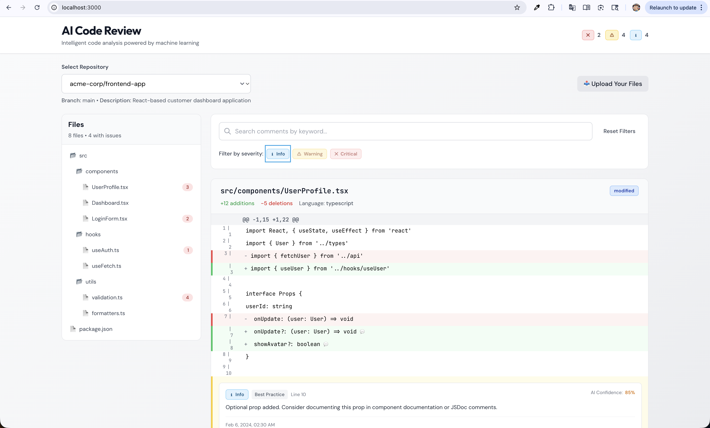
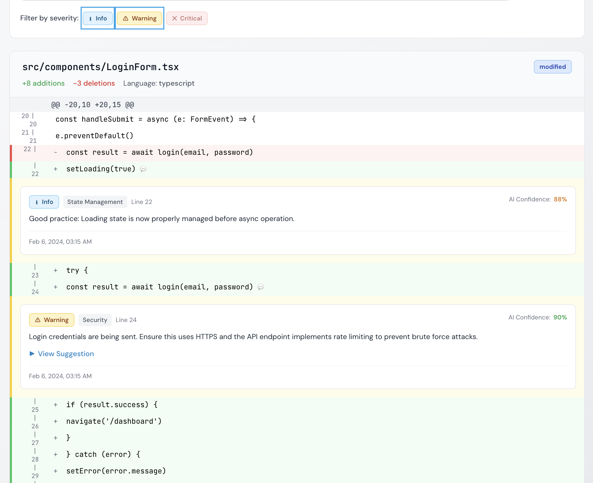
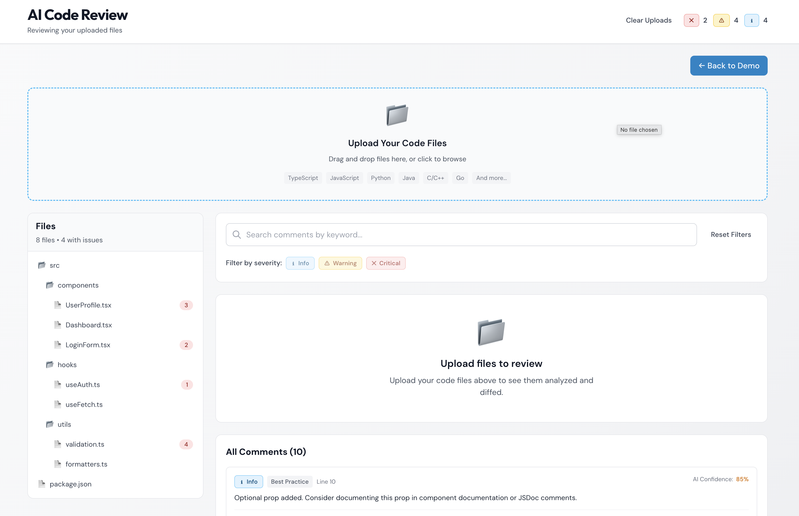
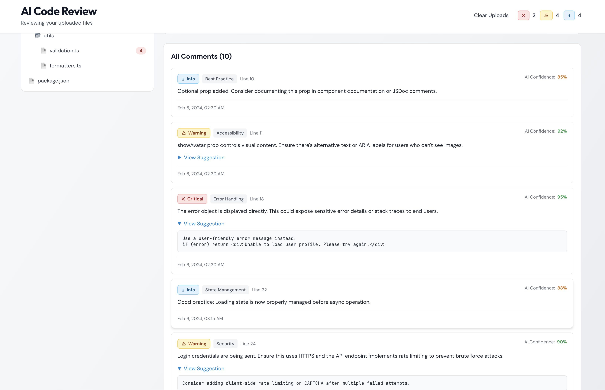

# AI Code Review Dashboard


A production quality frontend application for visualizing code diffs and AI generated review comments. Built with performance, accessibility, and maintainability as core principles.


## Why This Project?

As AI assisted code review tools become more common, developers still need fast, readable, and intuitive interfaces to understand and act on AI feedback. This project explores how modern frontend architecture, thoughtful UX, and performance optimizations can make AI powered code review practical and developer friendly similar to real world developer tools.

## Features

### Core Functionality

- **File Upload**: Drag & drop your own code files for instant diff viewing
- **Repository Selection**: Dropdown selector with repository metadata display
- **Interactive File Explorer**: Tree view with comment count badges and keyboard navigation
- **Advanced Diff Viewer**: Unified diff display with lazy-loaded Shiki syntax highlighting, line numbers, and windowed rendering for large diffs
- **AI Review Comments**: Inline comments with severity levels, categories, and AI confidence scores
- **Smart Filtering**: Filter by severity, search by keyword, and show only files with issues
- **Cached Data Fetching**: React Query powered fetching with caching, retries and per-section error/retry states

### Developer Experience

- **Full TypeScript**: Type-safe codebase with comprehensive type definitions
- **Keyboard Navigation**: Arrow keys (↑/↓) or vim-style (j/k) for file navigation
- **Responsive Design**: Mobile-first approach with adaptive layouts
- **Loading States**: Skeleton screens for better perceived performance
- **Error Handling**: Inline error states with retry for repos, files, diffs and reviews, upload error messages, and a top-level error boundary

## Architecture Decisions

### State Management Strategy

**Zustand for UI State**

- Repository and file selection
- Filter configurations
- UI-specific state
- Simple, performant, and type-safe

**React Query for Server State**

- Data fetching and caching
- Caching and retries
- Loading and error states

This separation provides clear boundaries between client and server state, improving maintainability and testability.

### Component Design Patterns

**Composition Over Inheritance**

- Small, focused components
- Reusable UI primitives
- Clear prop interfaces

**Memoization Strategy**

- `React.memo` for expensive list items (DiffLine)
- `useMemo` for derived data (filtered reviews, file counts)
- `useCallback` for event handlers passed to children

**Accessibility First**

- Semantic HTML elements
- ARIA labels and roles
- Keyboard navigation support
- Focus moves to the diff when a file is selected
- `aria-live` announcements for filter results and file counts
- Tree roles/`aria-expanded`/`aria-selected` on the file tree

### Performance Optimizations

1. **Code Splitting**: The dashboard and the syntax highlighter (plus each language grammar) load on demand
2. **Debounced Search**: 300ms delay to reduce unnecessary renders
3. **Diff Virtualization**: Diffs over 300 rows are windowed with `@tanstack/react-virtual`; comments are indexed by line for O(1) lookup
4. **Memoized Renders**: DiffLine components are memoized to prevent re-renders
5. **Lazy Highlighting**: Shiki (JS regex engine) is loaded only when a supported language is shown

## Screenshots

### Repository & File Explorer



### Filtering & Navigation



### File Upload with AI Comments



### Diff Viewer with AI Comments



## Future Improvements

- Mocked APIs used to isolate frontend concerns
- Tailwind CSS v4 migration (currently on v3)
- Syntax highlighting is per line, so constructs spanning lines (block comments, template literals) may be coloured imperfectly
- Test coverage focuses on critical interaction paths
- Backend integration can be added with minimal changes to the data layer

## To run the project

```bash
npm install
npm run dev        # http://localhost:3000
```

### Scripts

| Command | What it does |
|---|---|
| `npm run dev` | Start the Vite dev server |
| `npm run build` | Typecheck and build for production |
| `npm run lint` | ESLint (zero warnings allowed) |
| `npm run typecheck` | `tsc --noEmit` |
| `npm test` | Jest unit/component tests |
| `npm run format` | Prettier |

CI (`.github/workflows/ci.yml`) runs lint, typecheck, tests and build on every push and PR.
